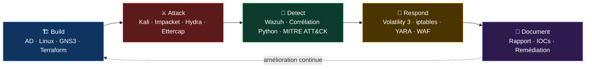
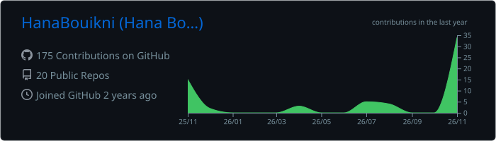
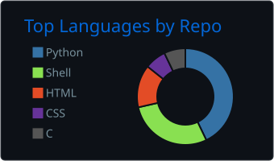
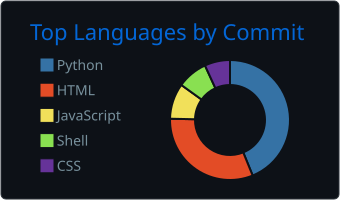
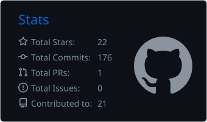

<!-- Bannière -->
<p align="center">
  
</p>

<p align="center">
  
</p>

<p align="center">
  
  
</p>

---

## 🛡️ À propos

```yaml
name:     Hana Bouikni
focus:    [Blue Team, SOC, Digital Forensics, Network Security, Cloud Security]
approach: "Build → Attack → Detect → Respond → Document"
```

Je conçois des **laboratoires de sécurité de bout en bout**. Je monte l'infrastructure, je l'attaque, je mets en place la détection et la réponse, puis je documente le tout dans un rapport technique détaillé.

---

## 🔄 Méthodologie



---

## 🏆 Projet phare : Mini-SOC de détection Active Directory

```mermaid
flowchart LR
    K["💀 Kali Linux<br/>Rubeus · Impacket · Hydra"] -- "AS-REP Roasting<br/>Kerberoasting<br/>Brute-force" --> DC["🖥️ Contrôleur de domaine<br/>lab.local"]
    DC -- "Agent Wazuh<br/>Event IDs 4768 · 4769 · 4625" --> W["🛡️ Wazuh SIEM<br/>règles Kerberos custom"]
    W --> P["🐍 Moteur de corrélation<br/>Python + MITRE ATT&CK"]
    P --> R["📊 Rapport d'alertes<br/>JSON · HTML"]

    style K fill:#5c1a1a,stroke:#ff6b6b,color:#fff
    style DC fill:#0F3460,stroke:#58A6FF,color:#fff
    style W fill:#0d3b2e,stroke:#39d353,color:#fff
    style P fill:#4a3500,stroke:#f0b429,color:#fff
    style R fill:#2d1b4e,stroke:#b392f0,color:#fff
```



<p align="center">
  <a href="https://github.com/HanaBouikni/mini-soc-ad-detection"></a>
</p>

---

## 🚀 Projets

<table>
<tr>
<td width="50%" valign="top">

### 📡 [WPA2-Enterprise](https://github.com/HanaBouikni/Securing-a-WLAN-with-WPA2-Enterprise)
Sécurisation d'un WLAN en 802.1X avec **Windows NPS (RADIUS)**, **AD CS (PKI)** et **hostapd**.

`802.1X` `RADIUS` `PKI` `PowerShell`

</td>
<td width="50%" valign="top">

### 🌐 [MPLS L3VPN sous GNS3](https://github.com/HanaBouikni/MPLS-L3VPN-sous-GNS3)
Réseau opérateur **BGP/MPLS VPN** (RFC 4364) avec deux clients isolés par **VRF** sur Cisco IOS.

`MPLS` `BGP` `OSPF` `LDP` `VRF`

</td>
</tr>
<tr>
<td width="50%" valign="top">

### 🔥 [Log4Shell Incident Report](https://github.com/HanaBouikni/Log4Shell-Incident-Report-CVE-2021-44228)
Réponse à **CVE-2021-44228** : détection JNDI, confinement, éradication, règles **WAF / YARA** et IOCs.

`Incident Response` `YARA` `WAF`

</td>
<td width="50%" valign="top">

### 🧠 [Volatility 3 Forensics](https://github.com/HanaBouikni/Volatility3-Forensics-Incident-Response)
Exploitation de **CVE-2021-3156**, capture mémoire **LiME** et analyse **Volatility 3**.

`Memory Forensics` `LiME` `Hydra`

</td>
</tr>
<tr>
<td width="50%" valign="top">

### ☁️ [Cloud IAM Security Lab](https://github.com/HanaBouikni/cloud-iam-security-lab)
Identités, politiques et **moindre privilège** en Infrastructure as Code avec **Terraform**.

`IAM` `Terraform` `IaC`

</td>
<td width="50%" valign="top">

### 🔐 [Secure PGP Messaging](https://github.com/HanaBouikni/Secure-PGP-Messaging)
Messagerie client/serveur **chiffrée et signée** sur le modèle PGP.

`Cryptographie` `PGP` `Python`

</td>
</tr>
</table>

<details>
<summary><b>🧪 Autres laboratoires</b></summary>
<br/>

| Lab | Thème |
|-----|-------|
| [AppArmor-Simulation-CVE-2021-3156](https://github.com/HanaBouikni/AppArmor-Simulation-CVE-2021-3156) | Confinement AppArmor face à Baron Samedit |
| [Lynis-chkrootkit-Timeshift-Forensique-SSH](https://github.com/HanaBouikni/Lynis-chkrootkit-Timeshift-Forensique-SSH) | Audit et durcissement Linux, forensique des logs SSH |
| [ARP-Spoofing-Man-in-the-Middle-Attack](https://github.com/HanaBouikni/ARP-Spoofing-Man-in-the-Middle-Attack) | MITM avec Ettercap, Wireshark et sslstrip |
| [Configuration-serveur-NGINX](https://github.com/HanaBouikni/Configuration-serveur-NGINX) | Reverse proxy, load balancing, failover et HTTPS |
| [Systeme-d-Authentification-Securise](https://github.com/HanaBouikni/Systeme-d-Authentification-Securise) | Hachage, salage et gestion des sessions |
| [Cryptosystem](https://github.com/HanaBouikni/Cryptosystem) | Cryptographie classique, symétrique et asymétrique |

</details>

---

## 🧰 Outils et technologies

<p align="center">
  
</p>

<p align="center">
  
  
  
  
  
  <br/>
  
  
  
  
  
</p>

---

## 📊 Statistiques GitHub

<p align="center">
  
</p>
<p align="center">
  
  
  
</p>
<p align="center">
  
</p>

---

## 🐍 Contributions

<picture>
  <source media="(prefers-color-scheme: dark)" srcset="https://raw.githubusercontent.com/HanaBouikni/HanaBouikni/output/snake-dark.svg" />
  <source media="(prefers-color-scheme: light)" srcset="https://raw.githubusercontent.com/HanaBouikni/HanaBouikni/output/snake.svg" />
  
</picture>

<!-- Pied de page -->
<p align="center">
  
</p>
